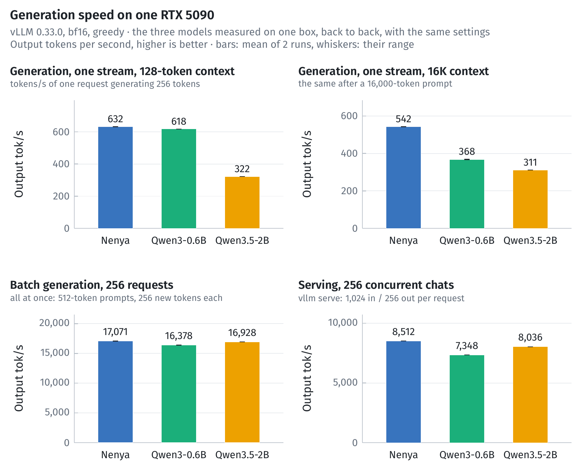
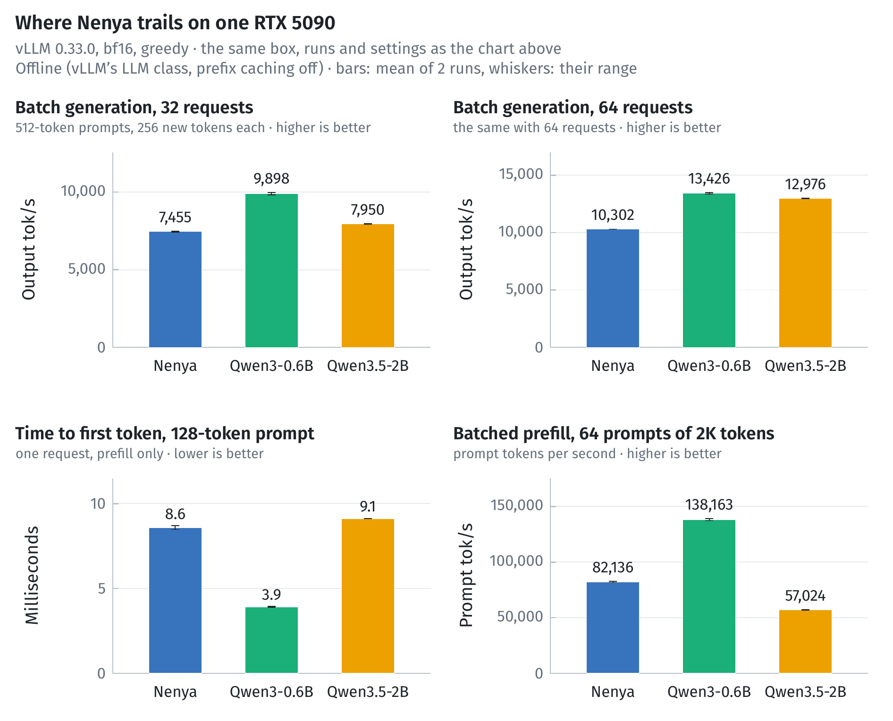

<div align="center" style="line-height: 1;">
  <a href="https://www.arsalanzafar.ai/nenya-technical-report" target="_blank"></a>
  <a href="https://huggingface.co/ArsalanZ/Nenya-2.5B-A0.5B-Base" target="_blank"></a>
  <a href="https://huggingface.co/ArsalanZ/Nenya-2.5B-A0.5B-Base-Metal-8bit" target="_blank"></a>
  <a href="https://pypi.org/project/nenya/" target="_blank"></a>
</div>
<div align="center" style="line-height: 1;">
  <a href="LICENSE" target="_blank"></a>
</div>

**nenya-vllm** is running Nenya-2.5B-A0.5B natively on [vLLM](https://github.com/vllm-project/vllm) 0.33.0. It's a
vLLM plugin with fused Triton kernels for the decode path, plus vLLM's OpenAI compatible server w/ Nenya's chat format &
tool parser. No vLLM fork. No `--trust-remote-code`.

- First model card
- Then [serving on vLLM](#quickstart) (first part of Quickstart)
- Then [vLLM benchmarks](#vllm-benchmarks) (charts & tables of speed & accuracy)
- [How to run the benchmarks](#how-to-run-the-benchmarks)

## Model overview

Nenya is a general purpose 0.5B active, 2.5B total parameter mixture-of-experts (MoE) base model.
Nenya rivals Qwen3.5 2B on pretraining benchmarks with 500× lower training compute and 3.4× fewer active FLOPs/token.

| Architecture | Mixture-of-Experts (MoE) |
|---|---|
| **Total Parameters** | 2.59B |
| **Activated Parameters** | 553M |
| **Routed-Expert Parameters** | 1.59B |
| **Engram Table Parameters** | 528M |
| **Number of Layers** | 32 |
| **Number of Dense Layers** | 2 (blocks 0–1) |
| **Attention-Layer Composition** | 23 (GDN-2) + 9 (MLA) |
| **Attention Hidden Dimension** | 960 |
| **Number of Attention Heads** | 12 |
| **Dense FFN Hidden Dimension** | 2560 (SwiGLU) |
| **Latent MoE Dimension** | 384 |
| **MoE Hidden Dimension** (per Expert) | 384 |
| **Number of Experts** | 120 |
| **Selected Experts per Token** | 6 |
| **Number of Shared Experts** | 2 |
| **Expert Routing** | quantile-balanced |
| **Residual Streams** | 4 |
| **Vocabulary Size** | 100,278 |
| **Padding Rows** | 74 |
| **Context Length** | 16,384 |
| **Attention Mechanism** | GDN-2 & MLA |
| **Activation Function** | SwiGLU |
| **Precision** | bf16 |
| **Modality** | Text |

## Quickstart

**On NVIDIA GPUs with vLLM** (this repository):

```bash
# vLLM 0.33.0 (pinned exactly: the plugin uses vLLM internals) and this plugin, which pulls flash-linear-attention 0.5.2
uv pip install "vllm==0.33.0" --torch-backend=auto
git clone https://github.com/Arsalan-zafar/nenya-vllm && uv pip install ./nenya-vllm

# the checkpoint, then a one-off patch of the local copy: token names for ids 100270/100271, stop ids, chat template
hf download ArsalanZ/Nenya-2.5B-A0.5B-Base --revision 8b7bb96599d01d99027227e08f4b646509881611 \
    --local-dir /models/nenya-base
python -m nenya_vllm.olmo3_chat export-hf /models/nenya-base

# vLLM's OpenAI-compatible server on port 8000, model name "nenya"
nenya-vllm/serve/serve.sh /models/nenya-base
```

```python
from openai import OpenAI

client = OpenAI(base_url="http://localhost:8000/v1", api_key="EMPTY")
r = client.completions.create(model="nenya", prompt="The mitochondrion is the organelle responsible for",
                              max_tokens=40)            # samples: temperature 0.9, top-k 20 (the model's defaults)
print(r.choices[0].text)
```

- Base is a continuation model. You will use `/v1/completions`. The chat template + `nenya` tool parser are installed
  too, for same-arch checkpoints tuned for chat.
- `serve/serve.sh` makes sure the checkpoint is patched, then executes the `vllm serve` below:
  ```bash
  vllm serve /models/nenya-base --served-model-name nenya \
      --chat-template "$(python -c 'import nenya_vllm; print(nenya_vllm.chat_template_path())')" \
      --enable-auto-tool-choice --tool-call-parser nenya --generation-config auto \
      --max-model-len 16384 --max-num-batched-tokens 8192 --host 0.0.0.0 --port 8000 \
      --middleware nenya_vllm.serving.NenyaServingMiddleware
  ```
  The header shows the environment variables. And you just pass additional arguments to `vllm serve`.
  `--max-num-batched-tokens 8192` is important. vLLM's default 2048 for < 70 GB GPU has 2.5x throughput drop on
  RTX 5090.
- Here is how the plugin gets loaded. vLLM uses the `vllm.general_plugins` entry point to call the plugin. The plugin
  registers the model (MLA, GDN-2, MoE, Engram, mHC layers on top of vLLM building blocks) and fused decode kernels
  (`nenya_vllm/ops/`) and tool parser. Nenya is executed using breakable CUDA graphs. There's no torch.compile.
- In the `serve/Dockerfile` I added the plugin to `vllm/vllm-openai:v0.33.0`. It hasn't been built yet.

**Any device with transformers**:

```python
import torch
from transformers import AutoModelForCausalLM, AutoTokenizer

device = "cuda" if torch.cuda.is_available() else "mps" if torch.backends.mps.is_available() else "cpu"
repo = "ArsalanZ/Nenya-2.5B-A0.5B-Base"
tok = AutoTokenizer.from_pretrained(repo, trust_remote_code=True)
model = AutoModelForCausalLM.from_pretrained(repo, trust_remote_code=True, dtype=torch.bfloat16).to(device)

inputs = tok("The mitochondrion is the organelle responsible for", return_tensors="pt").to(model.device)
out = model.generate(**inputs, max_new_tokens=40)     # samples: temperature 0.9, top-k 20 (the default)
print(tok.decode(out[0], skip_special_tokens=True))

# maths, code and short factual answers: greedy decoding
out = model.generate(**inputs, max_new_tokens=40, do_sample=False)
```

**Any device with PyPI**

Install it with `pip install "nenya[cuda]"` on NVIDIA
GPUs to get the flash-linear-attention kernels and `pip install "nenya"` otherwise. With the pip package, `trust_remote_code` is not needed:

```python
import torch
import nenya                                    # registers the model with transformers
from transformers import AutoModelForCausalLM, AutoTokenizer

device = "cuda" if torch.cuda.is_available() else "mps" if torch.backends.mps.is_available() else "cpu"
repo = "ArsalanZ/Nenya-2.5B-A0.5B-Base"
tok = AutoTokenizer.from_pretrained(repo)
model = AutoModelForCausalLM.from_pretrained(repo, dtype=torch.bfloat16).to(device)
```

**On a Mac with Apple silicon**, use the Metal engine for maximum throughput:

```bash
pip install "nenya[mac]"
```

```python
import nenya
print(nenya.generate("The mitochondrion is the organelle responsible for", max_new_tokens=40))
print(nenya.generate("Question: What is the capital of Australia?\nAnswer:", max_new_tokens=8, temperature=0))
```

It runs on the Mac's GPU, about 125 tok/s on an M4, and downloads its 3.5 GB weight file on first use. It samples
with the model's defaults (temperature 0.9, top-k 20); `temperature=0` is greedy decoding, for maths, code and short
factual answers.

- **Kernels:** on NVIDIA GPUs, install flash-linear-attention (the `cuda` extra, or `pip install
  flash-linear-attention`) so the GDN-2 layers run on its Triton kernels. Without it, on a CPU, or through
  transformers on a Mac, they run a pure-PyTorch recurrence: same results, much slower, especially on long prompts.
- **Precision:** use bf16, as it was trained and evaluated in. fp32 also works.

## Evaluation

#### Pretraining Benchmarks

Scored with [lm-evaluation-harness](https://github.com/EleutherAI/lm-evaluation-harness) 0.4.13 through transformers
(`--model hf`), from log-likelihoods only: no task generates text. Every model runs with the same settings:
- bf16 weights, fp32 log-softmax, 4,096-token windows
- zero-shot except TriviaQA (5-shot, otherwise Qwen's think token invalidates results), lm-eval's default seeds
- the reference models at their pinned commits

Our training data was decontaminated against these benchmarks' evaluation sets.

Four tasks are ours. Their files are in the [model repository](https://huggingface.co/ArsalanZ/Nenya-2.5B-A0.5B-Base/tree/main/evaluation/lm_eval_tasks)
under `evaluation/lm_eval_tasks`:
- `mmlu_cloze`: lm-eval's 57 `mmlu_*_continuation` tasks, grouped so that the pooled acc_norm is reported. The
  stock group reports only acc.
- `csqa_cloze`
- `triviaqa_5shot_greedy`
- `uncheatable_2026_07`

Accuracies are in %, ± one standard error.

| lm-eval task | Metric | Our model (0.06T tokens) | OLMo-2 1B (4T tokens) | Qwen3.5 0.8B (>10T tokens) | Qwen3.5 2B (>10T tokens) | Gemma 4 E2B (>10T tokens) | SmolLM3 3B (11.2T tokens) |
|---|---|---|---|---|---|---|---|
| `hellaswag` | acc_norm | 63.3 ± 0.5 | 68.3 ± 0.5 | 54.9 ± 0.5 | 66.0 ± 0.5 | 73.8 ± 0.4 | 75.2 ± 0.4 |
| `arc_easy` | acc | 75.1 ± 0.9 | 72.9 ± 0.9 | 70.5 ± 0.9 | 76.2 ± 0.9 | 79.7 ± 0.8 | 78.5 ± 0.8 |
| `arc_challenge` | acc_norm | 39.5 ± 1.4 | 41.6 ± 1.4 | 40.4 ± 1.4 | 45.8 ± 1.5 | 52.0 ± 1.5 | 52.1 ± 1.5 |
| `winogrande` | acc | 61.2 ± 1.4 | 64.5 ± 1.3 | 60.5 ± 1.4 | 65.7 ± 1.3 | 65.8 ± 1.3 | 67.9 ± 1.3 |
| `piqa` | acc_norm | 75.8 ± 1.0 | 75.8 ± 1.0 | 71.7 ± 1.1 | 74.9 ± 1.0 | 78.7 ± 1.0 | 78.6 ± 1.0 |
| `sciq` | acc_norm | 95.5 ± 0.7 | 95.2 ± 0.7 | 91.9 ± 0.9 | 93.2 ± 0.8 | 96.0 ± 0.6 | 92.1 ± 0.9 |
| `openbookqa` | acc_norm | 41.0 ± 2.2 | 39.8 ± 2.2 | 35.6 ± 2.1 | 37.6 ± 2.2 | 44.4 ± 2.2 | 45.0 ± 2.2 |
| `lambada_openai` | acc | 59.2 ± 0.7 | 64.9 ± 0.7 | 50.8 ± 0.7 | 58.4 ± 0.7 | 67.2 ± 0.7 | 69.7 ± 0.6 |
| `mmlu_cloze` | acc_norm | 39.3 ± 0.4 | 39.0 ± 0.4 | 35.3 ± 0.4 | 38.1 ± 0.4 | 44.2 ± 0.4 | 44.7 ± 0.4 |
| `csqa_cloze` | acc_norm | 45.8 ± 1.4 | 55.8 ± 1.4 | 39.1 ± 1.4 | 39.5 ± 1.4 | 53.2 ± 1.4 | 49.2 ± 1.4 |
| `xstorycloze_en` | acc | 70.5 ± 1.2 | 74.2 ± 1.1 | 64.7 ± 1.2 | 70.8 ± 1.2 | 75.0 ± 1.1 | 76.4 ± 1.1 |
| `triviaqa_5shot_greedy` | acc | 33.3 ± 0.7 | 40.9 ± 0.8 | 17.8 ± 0.6 | 31.1 ± 0.7 | 47.2 ± 0.8 | 49.0 ± 0.8 |
| **avg** | mean of all 12 | **58.3** | **61.1** | **52.8** | **58.1** | **64.8** | **64.9** |

- **TriviaQA:** 5-shot, on a fixed 4,000-question subset of the validation set. A question counts as right if
  greedy decoding reproduces any accepted alias, checked from log-likelihoods without generating. The examples
  show the short-answer format, so models that otherwise answer in sentences or `<think>` blocks (Qwen3.5 Base)
  are measured on knowledge.

#### UncheatableEval, July 2026 (bits per byte, lower is better)

The text was first published 1–25 July 2026 (`Jellyfish042/UncheatableEval-2026-07`), after every compared model's
training data. Each category has 500 documents, each scored as a whole after the model's document-start token, in
4,096-token windows. Each group's average is the plain mean of its categories.

| Group | Our model (0.06T tokens) | OLMo-2 1B (4T tokens) | Qwen3.5 0.8B (>10T tokens) | Qwen3.5 2B (>10T tokens) | Gemma 4 E2B (>10T tokens) | SmolLM3 3B (11.2T tokens) |
|---|---|---|---|---|---|---|
| English (3 categories) | 0.815 | 0.788 | 0.911 | 0.833 | 0.745 | 0.741 |
| Science: arXiv and bioRxiv (5 categories) | 0.674 | 0.677 | 0.667 | 0.605 | 0.624 | 0.626 |
| Code: GitHub (5 categories) | 0.637 | 0.676 | 0.578 | 0.505 | 0.500 | 0.507 |

#### Code and maths (bits per byte of the reference solution, lower is better)

lm-eval scores GSM8K, MBPP and HumanEval only by generating answers. These rows come from our own harness (context
1,024): the reference models in fp32 with TF32 matmuls, this model in bf16.

| Task | Our model (0.06T tokens) | OLMo-2 1B (4T tokens) | Qwen3.5 0.8B (>10T tokens) | Qwen3.5 2B (>10T tokens) | Gemma 4 E2B (>10T tokens) | SmolLM3 3B (11.2T tokens) |
|---|---|---|---|---|---|---|
| gsm8k_bpb | 0.446 | 0.430 | 0.459 | 0.420 | 0.452 | 0.396 |
| mbpp_bpb | 0.295 | 0.431 | 0.315 | 0.279 | 0.308 | 0.238 |
| humaneval_bpb | 0.292 | 0.368 | 0.280 | 0.243 | 0.246 | 0.216 |

#### Verify our results

The custom task files ship in the model repository. On a CUDA GPU:

```bash
# our runs: torch 2.11.0+cu128 on an RTX PRO 6000 Blackwell, datasets 5.0.1, huggingface_hub 1.33.0
pip install "lm-eval[hf]==0.4.13" "transformers==5.18.0" "torch==2.11.0" "flash-linear-attention==0.5.2" \
    "datasets==5.0.1"
hf download ArsalanZ/Nenya-2.5B-A0.5B-Base --include "evaluation/*" --local-dir nenya_eval
TASKS=nenya_eval/evaluation/lm_eval_tasks
ARGS=pretrained=ArsalanZ/Nenya-2.5B-A0.5B-Base,trust_remote_code=True,dtype=bfloat16,softmax_dtype=float32,max_length=4096
lm_eval --model hf --model_args $ARGS --include_path $TASKS --output_path results \
    --batch_size 32 --tasks hellaswag,arc_easy,arc_challenge,winogrande,piqa,sciq,openbookqa,lambada_openai,xstorycloze_en,csqa_cloze
lm_eval --model hf --model_args $ARGS --include_path $TASKS --output_path results \
    --batch_size 16 --tasks mmlu_cloze
lm_eval --model hf --model_args $ARGS --include_path $TASKS --output_path results \
    --batch_size 32 --tasks triviaqa_5shot_greedy
lm_eval --model hf --model_args $ARGS --include_path $TASKS --output_path results \
    --batch_size 2 --tasks uncheatable_2026_07
```

To score a reference model, set `ARGS` to its arguments below followed by `,dtype=bfloat16,softmax_dtype=float32,max_length=4096`.
Qwen3.5, Gemma 4 and SmolLM3 ran at half these batch sizes (their vocabularies are 128k–262k tokens). bf16 scores
can move slightly with the GPU and the batch size.

| Model | `--model_args` |
|---|---|
| Our model | `pretrained=ArsalanZ/Nenya-2.5B-A0.5B-Base,trust_remote_code=True` |
| OLMo-2 1B | `pretrained=allenai/OLMo-2-0425-1B,revision=a1847dff35000b4271fa70afc5db10fd29fedbdf` |
| Qwen3.5 0.8B | `pretrained=Qwen/Qwen3.5-0.8B-Base,revision=dc7cdfe2ee4154fa7e30f5b51ca41bfa40174e68` |
| Qwen3.5 2B | `pretrained=Qwen/Qwen3.5-2B-Base,revision=b1485b2fa6dfa1287294f269f5fb618e03d52d7c` |
| Gemma 4 E2B | `pretrained=google/gemma-4-E2B,revision=d29ff6b45f081a49ee2733a859c9c9c2d95d1a6f,add_bos_token=True` |
| SmolLM3 3B | `pretrained=HuggingFaceTB/SmolLM3-3B-Base,revision=d78a42f79198603e614095753484a04c10c2b940,prefix_token_id=128000` |

## vLLM benchmarks

Nenya-2.5B-A0.5B on this plugin, against Qwen3-0.6B and Qwen3.5-2B on vLLM's own implementations. All three models ran
on one machine, back to back, with the same settings.

#### Setup

| | |
|---|---|
| GPU | 1 × NVIDIA GeForce RTX 5090 (32 GB), power-limited to 400 W by the host (stock limit 575 W) |
| Host | AMD Ryzen 9 9950X3D (vast.ai) |
| Software | Python 3.12, vLLM 0.33.0, torch 2.14.0+cu130 (CUDA 13.0 wheels), flash-linear-attention 0.5.2, transformers 5.22.2 |
| Models | `ArsalanZ/Nenya-2.5B-A0.5B-Base` @ `8b7bb965`, `Qwen/Qwen3-0.6B-Base` @ `da87bfb6`, `Qwen/Qwen3.5-2B-Base` @ `b1485b2f` (vision encoder off) |
| Settings, every model | bf16; `max_model_len` 16,384; `gpu_memory_utilization` 0.85; up to 256 sequences offline; step budget (`max_num_batched_tokens`) 16,384 offline, 8,192 online; greedy, `ignore_eos`; each model's default compilation and CUDA graphs |
| Prefix caching | off offline; vLLM's default (on) online |
| Runs | two rounds, models in alternating order; every number is the mean of the two runs. Throughput differs by at most 1.5% between runs. |
| Nenya engine | the plugin's defaults (no `NENYA_*` overrides): fused decode kernels, breakable CUDA graphs, no torch.compile; Triton and fla autotuning results kept on disk (`TRITON_CACHE_AUTOTUNING=1`, `FLA_CACHE_RESULTS=1`) |
| Not recorded | the NVIDIA driver version, the container image, and the host RAM and CPU cores given to the container. This repository's own check ran on driver 580.178.04 with the image `vastai/pytorch:cuda-13.0.3-auto`. |

To match the power limit on your own RTX 5090, cap it with `sudo nvidia-smi -pl 400`, where the host allows it.

**Offline workloads** (vLLM's `LLM` class, `benchmarks/compare_offline.py`). The prompts are windows of real text,
tokenized by each model's own tokenizer.

| Workload | What runs | Reported |
|---|---|---|
| Decode, one stream | one request: 256 new tokens after a 128 / 2K / 8K / 16K-token prompt | 256 / (time for 257 tokens − time for 1) |
| Decode, batch *B* | *B* requests of 512 prompt + 256 new tokens, *B* = 1 to 256 | generated tokens per second of decoding |
| Time to first token | one request, `max_tokens=1`, at 128 / 512 / 2K / 8K / 16K prompt tokens | median latency of at least 3 runs |
| Batched prefill | 64 × 2,048 and 16 × 8,192 prompt tokens at once, `max_tokens=1` | prompt tokens per second |
| Offline batch | 256 requests × (1,024 in, 256 out) at once | output tokens per second, prefill included |

**Online workloads** (`vllm serve`, driven by `vllm bench serve` on `/v1/completions`, `benchmarks/compare_serve.sh`).
Random-token prompts, greedy, `ignore_eos`, a closed loop at a fixed concurrency.

| Scenario | Prompt / output tokens | Concurrency | Requests |
|---|---|---|---|
| Chat | 1,024 / 256 | 1, 16, 64, 256 | 32, 128, 128, 512 |
| Long prompt | 8,192 / 256 | 1, 16 | 12, 64 |
| Shared prefixes | one of 4 shared 4,096-token prefixes + 256 tokens / 128 | 32 | 256 |

#### Speed





**Offline** (best of each row in bold; tok/s: higher is better, ms: lower is better)

| Workload | Nenya-2.5B-A0.5B | Qwen3-0.6B | Qwen3.5-2B |
|---|---|---|---|
| Decode, one stream, 128-token context (tok/s) | **632** | 618 | 322 |
| Decode, one stream, 2K context (tok/s) | **615** | 580 | 320 |
| Decode, one stream, 8K context (tok/s) | **579** | 426 | 316 |
| Decode, one stream, 16K context (tok/s) | **542** | 368 | 311 |
| Decode, batch 1 (tok/s) | **630** | 613 | 321 |
| Decode, batch 8 (tok/s) | 3,266 | **3,553** | 2,053 |
| Decode, batch 32 (tok/s) | 7,455 | **9,898** | 7,950 |
| Decode, batch 64 (tok/s) | 10,302 | **13,426** | 12,976 |
| Decode, batch 128 (tok/s) | 14,198 | 15,177 | **15,276** |
| Decode, batch 256 (tok/s) | **17,071** | 16,378 | 16,928 |
| Time to first token, 128-token prompt (ms) | 8.6 | **3.9** | 9.1 |
| Time to first token, 512-token prompt (ms) | 13.9 | **6.1** | 13.2 |
| Time to first token, 2K-token prompt (ms) | 27.9 | **18.0** | 40.2 |
| Time to first token, 8K-token prompt (ms) | 110 | **95.6** | 152 |
| Time to first token, 16K-token prompt (ms) | **232** | 264 | 321 |
| Batched prefill, 64 × 2K-token prompts (tok/s) | 82,136 | **138,163** | 57,024 |
| Batched prefill, 16 × 8K-token prompts (tok/s) | 76,194 | **88,680** | 53,272 |
| Offline batch, 256 × (1,024 in, 256 out), output (tok/s) | **8,801** | 7,136 | 7,377 |

**Online, output tokens per second**

| Scenario | Nenya-2.5B-A0.5B | Qwen3-0.6B | Qwen3.5-2B |
|---|---|---|---|
| Chat, 1,024 in / 256 out, 1 concurrent | **588** | 584 | 305 |
| Chat, 1,024 in / 256 out, 16 concurrent | 4,047 | **4,258** | 3,109 |
| Chat, 1,024 in / 256 out, 64 concurrent | 7,076 | 8,561 | **8,882** |
| Chat, 1,024 in / 256 out, 256 concurrent | **8,512** | 7,348 | 8,036 |
| Long prompt, 8,192 in / 256 out, 1 concurrent | **446** | 360 | 260 |
| Long prompt, 8,192 in / 256 out, 16 concurrent | **1,669** | 947 | 1,235 |
| Shared prefixes, 4 × 4,096 + 256 in / 128 out, 32 concurrent | **4,821** | 3,153 | 4,707 |

**Online, median time to first token (ms)**

| Scenario | Nenya-2.5B-A0.5B | Qwen3-0.6B | Qwen3.5-2B |
|---|---|---|---|
| Chat, 1,024 in / 256 out, 1 concurrent | 24.8 | **14.6** | 28.5 |
| Chat, 1,024 in / 256 out, 16 concurrent | 175 | **39.3** | 160 |
| Chat, 1,024 in / 256 out, 64 concurrent | 351 | **38.7** | 309 |
| Chat, 1,024 in / 256 out, 256 concurrent | **491** | 883 | 1,604 |
| Long prompt, 8,192 in / 256 out, 1 concurrent | 132 | **114** | 172 |
| Long prompt, 8,192 in / 256 out, 16 concurrent | 713 | **272** | 406 |
| Shared prefixes, 4 × 4,096 + 256 in / 128 out, 32 concurrent | 213 | **63.9** | 111 |

**Online, median time per output token after the first (ms)**

| Scenario | Nenya-2.5B-A0.5B | Qwen3-0.6B | Qwen3.5-2B |
|---|---|---|---|
| Chat, 1,024 in / 256 out, 1 concurrent | **1.6** | 1.7 | 3.1 |
| Chat, 1,024 in / 256 out, 16 concurrent | **3.3** | 3.6 | 4.5 |
| Chat, 1,024 in / 256 out, 64 concurrent | 7.7 | 7.2 | **6.0** |
| Chat, 1,024 in / 256 out, 256 concurrent | 27.6 | **27.1** | 27.2 |
| Long prompt, 8,192 in / 256 out, 1 concurrent | **1.7** | 2.3 | 3.2 |
| Long prompt, 8,192 in / 256 out, 16 concurrent | **7.5** | 16.3 | 12.4 |
| Shared prefixes, 4 × 4,096 + 256 in / 128 out, 32 concurrent | **4.8** | 9.6 | 5.7 |

- **Where Nenya leads:**
  - single-stream decode, at every context length;
  - long contexts: its decode speed drops 14% from a 128-token to a 16K context, against 40% for Qwen3-0.6B;
  - long prompts under load;
  - batch 256.
- **Where it trails:**
  - decode at batch 8 to 128 (at batch 64, 0.77× Qwen3-0.6B);
  - time to first token on short prompts (8.6 vs 3.9 ms at 128 tokens);
  - batched prefill of 2K-token prompts (0.59× Qwen3-0.6B).
- **Prefix caching in the online runs.** The online runs kept vLLM's default prefix caching. During the chat
  scenarios the server logged prefix-cache hit rates of up to 55% for Qwen3-0.6B and up to 31% for Qwen3.5-2B, and
  none for Nenya. Nenya's hybrid
  cache aligns to 1,280-token blocks, so a 1,024-token prompt never fills one. This flatters the Qwen models' chat
  time to first token. In a separate session on the same machine with `--no-enable-prefix-caching`, Nenya against
  Qwen3-0.6B gave:
  - 16 concurrent chats: 4,113 vs 4,156 output tok/s, median time to first token 200 vs 81 ms;
  - 64 concurrent chats: 7,157 vs 7,216 output tok/s, median time to first token 453 vs 217 ms.
- **Power limit.** The host caps the GPU at 400 W, so from batch 32 up every model runs power-limited. An uncapped
  RTX 5090 gives higher absolute numbers. Qwen3.5-2B reached 18,440 tok/s at batch 256 on an uncapped card, against
  16,928 here.

#### Accuracy

vLLM scores the same token sequences as reference outputs of the HF release code, in bf16 and in fp32 (the exact
model). Measured with this repository on an RTX 5090:

| Against the HF release in fp32 | Mean \|Δ log-prob\| | Top-1 agreement | Mean NLL Δ |
|---|---|---|---|
| This plugin, 16 sequences of 1,024 tokens | 0.0237 | 97.66% | +0.00035 |
| HF release in bf16, the same sequences | 0.0253 | 97.60% | +0.00068 |
| This plugin, 2 sequences of 16,000 tokens | 0.0216 | 98.39% | +0.00000 |
| HF release in bf16, the same sequences | 0.0230 | 98.41% | +0.00023 |

- The plugin is as close to the exact model as the HF release's own bf16 build.
- Through vLLM, the model card's 12-task lm-eval suite averages 58.26 (card: 58.28), and UncheatableEval's 13
  categories average 0.6928 bits per byte (card: 0.6925). These two come from an earlier validation of the same engine
  build; the table above is from this repository's own check.
- `pytest -q tests/test_kernels.py` checks each fused kernel against its PyTorch or fp64 reference: all 152 tests
  pass.

## How to run the benchmarks

Everything runs on one Linux machine with an NVIDIA GPU. It was tested on an RTX 5090 with a CUDA 13 driver, using
the vast.ai image `vastai/pytorch:cuda-13.0.3-auto`. Compare models only on the same machine: the host CPU, the GPU's
power limit and its clocks move absolute numbers by more than the differences between models.

**1. Set up** (about 35 minutes on a fresh machine, most of it FlashInfer's one-time build of its fused-MoE kernels):

```bash
git clone https://github.com/Arsalan-zafar/nenya-vllm && cd nenya-vllm
WITH_QWEN=1 bash benchmarks/setup_box.sh > setup.log 2>&1      # ends with SETUP_DONE
source /root/vllm_env/bin/activate
```

`setup_box.sh` does five things:
- creates a virtual environment (`VENV`, default `/root/vllm_env`);
- installs vLLM 0.33.0 and this plugin;
- downloads the checkpoints into `MODELS_DIR` (default `/root/models`);
- patches Nenya's local copy once (`export-hf`);
- generates a few tokens to build the JIT kernels.

It installs CUDA 13 wheels by default, which Blackwell GPUs need. On other GPUs, set `TORCH_BACKEND=auto`. Without
`WITH_QWEN=1` it downloads Nenya only. `MAX_JOBS` (default 6) sets how many compiler jobs FlashInfer's build runs at
once; raise it on a machine with plenty of RAM.

**2. Run the comparison** (about 5 minutes per model and round on the machine above, so about 30 minutes for three
models × two rounds; 8–9 minutes per model and round on a slower host):

```bash
benchmarks/compare_models.sh 2>&1 | tee compare.log
python benchmarks/summarize.py          # the tables above, from results/
```

- `MODELS="nenya" ROUNDS=1 benchmarks/compare_models.sh` runs a subset.
- Each run writes `results/<model>_r<round>/`:
  - `offline.json` and `offline.log`;
  - `serve/<scenario>.json` and `.log`;
  - `serve/server.log`;
  - `serve/nvsmi.csv`: power and utilisation every 200 ms.
- `summarize.py` prints the offline and online tables, each value the mean of the rounds.

**3. One model, one part:**

```bash
python benchmarks/compare_offline.py --model /root/models/nenya-base --name nenya_test         # --quick: fewer sizes
bash benchmarks/compare_serve.sh /root/models/nenya-base nenya_test                            # starts vllm serve itself
python benchmarks/summarize.py
```

- `compare_offline.py`:
  - `--text FILE` changes the text the prompts are cut from;
  - `--extra '{...}'` passes extra `LLM(...)` arguments.
- `compare_serve.sh`:
  - takes extra `vllm serve` arguments after the name;
  - uses `PORT` (default 8000).

**4. Your own load** against a running server (`serve/serve.sh /root/models/nenya-base &`):

```bash
vllm bench serve --backend vllm --endpoint /v1/completions --port 8000 --model nenya \
    --tokenizer /root/models/nenya-base --trust-remote-code --dataset-name random \
    --random-input-len 1024 --random-output-len 256 --random-range-ratio 0 --ignore-eos --temperature 0 \
    --max-concurrency 64 --num-prompts 128
```

**5. Kernels.** These are microbenchmarks of single kernels, timed as CUDA-graph replays like vLLM's decode step:

```bash
python benchmarks/bench_kernels.py gemv     # or: chain, boundary, gemm, gemm_tune, gemm_split, boundary_bt, gdn_in,
                                            #     moe_in, gdn_varlen, moe_grouped
pytest -q tests/test_kernels.py             # every fused kernel against its PyTorch / fp64 reference
```

**Notes**
- The offline prompts are windows of `benchmarks/data/origin_of_species.txt`, an excerpt of Charles Darwin's *On
  the Origin of Species* (1859, public domain). The published runs cut
  their prompts from about 64K tokens of other English technical text and code, so a rerun reads different tokens.
- `compare_models.sh` keeps Triton's and fla's autotuning results on disk (`TRITON_CACHE_AUTOTUNING=1`,
  `FLA_CACHE_RESULTS=1`), so every run of a model uses the same kernel configurations. On a fresh machine the
  warm-up of the first run does the autotuning.
- `compare_serve.sh` serves every model with
  `vllm serve MODEL --dtype bfloat16 --max-model-len 16384 --gpu-memory-utilization 0.85 --max-num-batched-tokens 8192`.
- Absolute numbers depend strongly on the host CPU. Nenya's stateful layers (GDN-2, Engram) run eagerly between
  CUDA-graph segments, so part of every step is launched from the CPU. On an RTX 5090 with a slower, busy host
  (AMD EPYC 7R12), this code reached 217 tok/s at one stream and 7,309 tok/s at batch 256, with the GPU at 40–55% SM
  utilisation. The Ryzen 9 9950X3D machine above reached 632 and 17,071.

## Limitations

- A base model. It continues text, it does not follow instructions, and it can produce false, biased or unsafe
  content.
- Trained mostly on English web, educational, academic, code and maths data.
- Quality past 16,384 tokens is untested. With no positional encoding there is no hard limit.

## License

Apache 2.0: see [`LICENSE`](LICENSE). [`NOTICE`](NOTICE) lists the third-party material:
- `nenya_vllm/ops/dilated_conv.py` is copied from [vLLM](https://github.com/vllm-project/vllm) (Apache 2.0);
- `nenya_vllm/model_state.py` is adapted from vLLM;
- `benchmarks/data/origin_of_species.txt` is in the public domain.

The model's weights and tokenizer are licensed in the [model repository](https://huggingface.co/ArsalanZ/Nenya-2.5B-A0.5B-Base).

## Citation

Nenya builds on Engram, mHC, Gated DeltaNet-2 and Mixture-of-Experts:

```bibtex
% Engram: conditional memory via hashed n-gram lookup
@misc{cheng2026conditionalmemoryscalablelookup,
      title={Conditional Memory via Scalable Lookup: A New Axis of Sparsity for Large Language Models},
      author={Xin Cheng and Rui Tian and Wangding Zeng and Damai Dai and Qinyu Chen and Bingxuan Wang and Zhenda Xie and Kezhao Huang and Xingkai Yu and Chengqi Deng and Shangyan Zhou and Chenggang Zhao and Zhewen Hao and Yukun Li and Han Zhang and Zhengyan Zhang and Yixu Wei and M. Y Xu and Huishuai Zhang and Dongyan Zhao and Wenfeng Liang},
      year={2026},
      eprint={2601.07372},
      archivePrefix={arXiv},
      primaryClass={cs.CL},
      url={https://arxiv.org/abs/2601.07372},
}

% mHC: manifold-constrained hyper-connections
@misc{xie2026mhcmanifoldconstrainedhyperconnections,
      title={mHC: Manifold-Constrained Hyper-Connections},
      author={Zhenda Xie and Yixuan Wei and Huanqi Cao and Chenggang Zhao and Chengqi Deng and Jiashi Li and Damai Dai and Huazuo Gao and Jiang Chang and Kuai Yu and Liang Zhao and Shangyan Zhou and Zhean Xu and Zhengyan Zhang and Wangding Zeng and Shengding Hu and Yuqing Wang and Jingyang Yuan and Lean Wang and Wenfeng Liang},
      year={2026},
      eprint={2512.24880},
      archivePrefix={arXiv},
      primaryClass={cs.CL},
      url={https://arxiv.org/abs/2512.24880},
}

% Gated DeltaNet-2
@misc{hatamizadeh2026gateddeltanet2decouplingerase,
      title={Gated DeltaNet-2: Decoupling Erase and Write in Linear Attention},
      author={Ali Hatamizadeh and Yejin Choi and Jan Kautz},
      year={2026},
      eprint={2605.22791},
      archivePrefix={arXiv},
      primaryClass={cs.AI},
      url={https://arxiv.org/abs/2605.22791},
}

% Mixture-of-Experts: the sparsely-gated MoE layer
@misc{shazeer2017outrageouslylargeneuralnetworks,
      title={Outrageously Large Neural Networks: The Sparsely-Gated Mixture-of-Experts Layer},
      author={Noam Shazeer and Azalia Mirhoseini and Krzysztof Maziarz and Andy Davis and Quoc Le and Geoffrey Hinton and Jeff Dean},
      year={2017},
      eprint={1701.06538},
      archivePrefix={arXiv},
      primaryClass={cs.LG},
      url={https://arxiv.org/abs/1701.06538},
}

% Mixture-of-Experts: fine-grained and shared experts (DeepSeekMoE)
@misc{dai2024deepseekmoeultimateexpertspecialization,
      title={DeepSeekMoE: Towards Ultimate Expert Specialization in Mixture-of-Experts Language Models},
      author={Damai Dai and Chengqi Deng and Chenggang Zhao and R. X. Xu and Huazuo Gao and Deli Chen and Jiashi Li and Wangding Zeng and Xingkai Yu and Y. Wu and Zhenda Xie and Y. K. Li and Panpan Huang and Fuli Luo and Chong Ruan and Zhifang Sui and Wenfeng Liang},
      year={2024},
      eprint={2401.06066},
      archivePrefix={arXiv},
      primaryClass={cs.CL},
      url={https://arxiv.org/abs/2401.06066},
}
```
